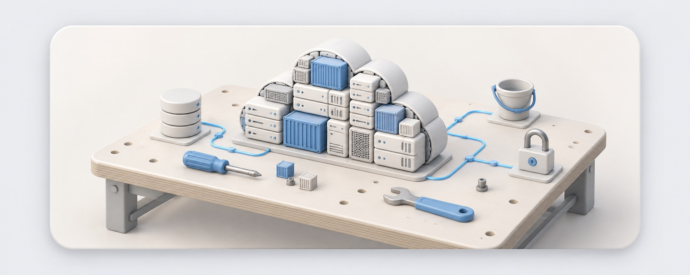
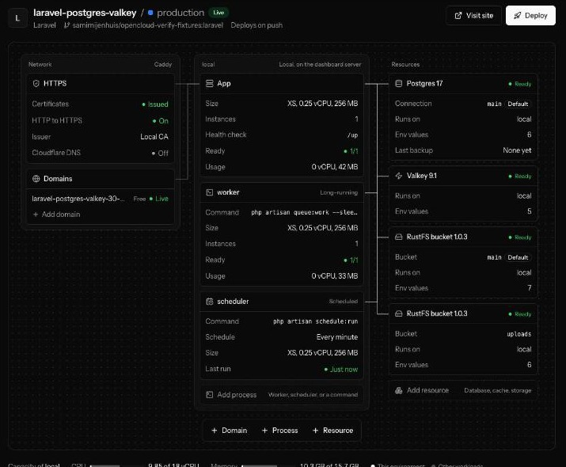
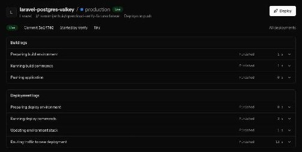
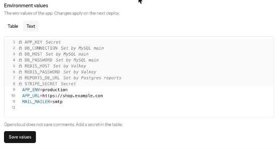
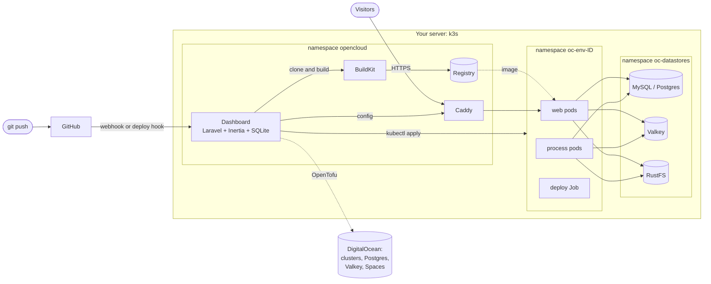

<p align="center">
  
</p>

<h1 align="center">opencloud</h1>

<p align="center">
  <strong>A hobby project that rebuilds a tiny part of a platform like Laravel Cloud, to learn how such a platform works.</strong><br>
  Push to GitHub. Opencloud builds your app, deploys it on Kubernetes on your own server, and gives it HTTPS, databases, and buckets.
</p>

<p align="center">
  
  
  
  
  
  
</p>

<p align="center">
  <a href="#quick-start">Quick start</a> ·
  <a href="#features">Features</a> ·
  <a href="#how-it-works">How it works</a> ·
  <a href="#hidden-mechanisms">Hidden mechanisms</a> ·
  <a href="docs/architecture.md">Architecture</a> ·
  <a href="#built-on-the-work-of-others">Credits</a>
</p>

> [!WARNING]
> **Opencloud is not a Laravel Cloud alternative, in any way.** It is a hobby project. Its purpose is to understand how something like [Laravel Cloud](https://cloud.laravel.com) works, by building a very small part of it. Laravel Cloud is a real product with a team, global infrastructure, support, and years of work behind it. Opencloud has none of these. It has no public release, no security review, and no promise of support. Do not run anything important on it.
>
> Opencloud is not affiliated with Laravel, and Laravel does not endorse it. "opencloud" is a working name.

## Contents

- [What opencloud does](#what-opencloud-does)
- [Features](#features)
- [Quick start](#quick-start)
- [How it works](#how-it-works)
- [Hidden mechanisms](#hidden-mechanisms)
- [Commands on the server](#commands-on-the-server)
- [Restore a lost server](#restore-a-lost-server)
- [What is proven, and what is not](#what-is-proven-and-what-is-not)
- [Leaving opencloud](#leaving-opencloud)
- [Development](#development)
- [Not built yet](#not-built-yet)
- [Built on the work of others](#built-on-the-work-of-others)
- [License](#license)

## What opencloud does

You install opencloud on one Ubuntu server, or on your Mac with OrbStack. You connect a GitHub repository in its dashboard. Opencloud then does the work that a deploy platform does:

1. It clones the commit and builds an image with BuildKit. A preset writes the Dockerfile for you, or you bring your own.
2. It runs your deploy commands, for example the database migrations, in a Kubernetes Job.
3. It rolls out the new version with no downtime. A failed step keeps the old version live.
4. It sends traffic through Caddy, with a free HTTPS address and your own domains.
5. It gives each environment its own MySQL or Postgres database, Valkey, and S3 buckets, and it writes the env values that your framework reads.

Everything runs on servers and cloud accounts that you own, with your own API keys.

<p align="center">
  <br>
  <sub>The environment canvas on a real test machine. Each block opens its settings. The lines show what connects to what.</sub>
</p>

<table align="center">
  <tr>
    <td align="center"><br><sub>Build logs and deployment logs, one row for each step</sub></td>
    <td align="center"><br><sub>The env Text mode, with locked rows</sub></td>
  </tr>
</table>

## Features

**Deploys**

- Push to deploy, a Deploy button, and a deploy hook URL for CI.
- Deploys with no downtime. Each deploy waits until the old pods stop before it marks the new version live.
- Build logs and deployment logs, split into 7 steps, each with its status, its duration, and its lines. The page follows a running deploy and updates by itself.
- Preview environments for pull requests, each with its own database and domain.

**Apps**

- Presets for Laravel, Node.js, Python, Ruby, and static sites, plus your own Dockerfile. A preset knows the port, the health check, the build, and the start command.
- Multi-line build commands and deploy commands, in an editor with shell highlighting.
- Processes next to web, each with its own size and its own autoscaling:
  - a **long-running** process, for example a queue worker, Horizon, Reverb, or `php artisan schedule:work`;
  - a **scheduled** process, a Kubernetes CronJob for a command that ends, for example a cleanup script.
- One-off commands, live pod logs, and the live CPU and memory of each process.

**Resources**

- MySQL, Postgres, Valkey, and RustFS buckets. Each one has three sources:

  | Source | What it is |
  |---|---|
  | Standard | Opencloud runs the server in your cluster. Each environment gets its own database, user, or bucket. |
  | Managed | OpenTofu creates it at DigitalOcean with your key: Postgres, Valkey, or a Spaces bucket. |
  | External | You type the address of a server that you already run. |

- Several databases and several buckets in one environment, each with a name and one default.
- Env names that fit your framework, as on Laravel Cloud. A Laravel app gets `DB_HOST` and the other Laravel names. Other apps get `DATABASE_URL`, `REDIS_URL`, and the AWS SDK names. A Dockerfile app gets both sets.

**Domains and HTTPS**

- A free address for each environment, `<app>-<environment>.<ip>.sslip.io`, with no DNS step.
- Your own domains. Caddy gets each certificate and renews it. The dashboard shows the exact DNS record to add and checks it. An optional Cloudflare mode writes the record for you.

**Env values**

- A table view, and a Text mode: one highlighted `.env` editor with locked rows for the values that a resource sets and for secrets.
- Secrets can never be read back, and every log masks them.

**Git access**

- Public repositories work with no setup.
- A private repository uses a deploy key (opencloud makes one, or you paste your own) or the GitHub App.

**Teams, backups, and operations**

- The roles owner, admin, and developer, and protected environments.
- Nightly database dumps to the server disk or to S3, a restore button, and nightly bucket copies.
- A full restore of a lost server from the S3 backup, and an upgrade command that rolls back on failure.
- More clusters: connect any Kubernetes cluster with its kubeconfig, or let OpenTofu create one at DigitalOcean.

## Quick start

> [!NOTE]
> Opencloud has no published release yet. You build it from this repository.

### On your Mac

You need [OrbStack](https://orbstack.dev), about 8 GB of free memory, and 20 GB of free disk space.

```bash
git clone <this repository> opencloud && cd opencloud
./scripts/try-on-mac.sh
```

The script creates a Linux machine in OrbStack, builds opencloud from your checkout, and runs the real installer on that machine. At the end, it prints the dashboard address and a setup URL. [Run opencloud on your Mac](docs/run-on-your-mac.md) has the details.

### On a Linux server

You need Ubuntu 24.04 with at least 2 vCPU, 4 GB of RAM, a public IP address, and open ports 80, 443, and 8000.

1. On a computer with Docker, build the two images for the CPU type of the server (`linux/amd64` or `linux/arm64`):

   ```bash
   git clone <this repository> opencloud && cd opencloud
   docker build --platform linux/amd64 --build-context tofu=tofu -t ghcr.io/opencloud-dev/opencloud:dev dashboard
   docker build --platform linux/amd64 -t ghcr.io/opencloud-dev/opencloud-caddy:dev platform/images/caddy
   docker save -o opencloud.tar ghcr.io/opencloud-dev/opencloud:dev
   docker save -o caddy.tar ghcr.io/opencloud-dev/opencloud-caddy:dev
   ```

2. Copy the `opencloud` folder, with the two archives in it, to the server.
3. On the server, run the installer from that folder:

   ```bash
   sudo OPENCLOUD_VERSION=dev OPENCLOUD_IMAGE_ARCHIVE=$PWD/opencloud.tar OPENCLOUD_CADDY_IMAGE_ARCHIVE=$PWD/caddy.tar ./install.sh
   ```

The installer checks the server first. It stops with a clear message when something is missing. At the end, it prints a setup URL. Only a person with that URL can create the owner account.

> [!IMPORTANT]
> Keep a copy of `/var/lib/opencloud/APP_KEY` in a safe place. The dashboard encrypts its secrets and the OpenTofu state with this key. Without it, nobody can read that data again.

### First steps

1. Open the setup URL and create the owner account.
2. Open **Applications > New application**. A repository is enough, because every other field has a default.
3. For a private repository, select **Private repository: use a deploy key**. Then add the public key on GitHub under **Settings > Deploy keys**.
4. Add a domain. The dashboard shows the DNS record to add.
5. Open **Settings > Members** to invite people, and **Settings > Backups** to add an S3 bucket.

## How it works

The installer turns the server into a one-node Kubernetes cluster with k3s. The dashboard is a Laravel app with a SQLite database, and it runs in that same cluster.



### One deploy, step by step

| Phase | Step | What happens |
|---|---|---|
| Build | Preparing build environment | Git clones the commit. The preset writes the Dockerfile. |
| Build | Running build commands | `buildctl` builds the image. Build-time env values go in as BuildKit secrets, never as build arguments. |
| Build | Pushing application | The image goes to the registry of the cluster. |
| Deploy | Preparing deploy environment | Opencloud waits for the resources, and it writes a new env Secret for this deployment only. |
| Deploy | Running deploy commands | A Kubernetes Job runs your deploy commands with the new image and env. |
| Deploy | Updating environment stack | Opencloud applies the Deployments, the CronJobs, and the autoscalers, and it waits for the rollout. |
| Deploy | Routing traffic to new deployment | Opencloud waits until the old pods stop. Then it marks the deployment live and syncs Caddy. |

### The main design choices

- **Every change goes through one Action.** A controller validates in a Form Request, checks a policy, and calls one Action, which records an audit event. [`.claude/rules/architecture.md`](.claude/rules/architecture.md) and an Architecture test suite hold this shape.
- **Resources are families and sources.** A database, a key-value store, and a bucket are families. Standard, managed, and external are sources. One registry, `Provisioners`, finds the code for each pair, so a managed database never reaches `kubectl`.
- **A provider gives a neutral connection, and the preset picks the env names.** A provisioner returns, for example, a host, a port, a user, and a password. A profile turns that into `DB_HOST` or `DATABASE_URL`.
- **Each job converges.** A deploy sends the full desired state with `kubectl apply`, and it deletes old processes by label. So a deploy reaches the same result when it runs twice or after a crash.

[`docs/architecture.md`](docs/architecture.md) describes each part, and [the design document](docs/superpowers/specs/2026-10-22-opencloud-design.md) explains why opencloud works this way.

## Hidden mechanisms

These behaviors are easy to miss, because no screen shows them. [`.claude/rules/hidden-mechanisms.md`](.claude/rules/hidden-mechanisms.md) lists them for contributors, with file and line references.

<details>
<summary><strong>Deploys and env values</strong></summary>

- Each deployment gets its own env Secret, `env-<deployment id>`. A failed deploy cannot change the env of the pods that still run. After a deployment goes live, opencloud keeps the live Secret and the two newest, and it deletes the rest.
- Each deploy writes the env values of every resource again from the current rules. A value that you type always wins over a value that a resource sets.
- A rollout ends when the old pods start to stop. But each old pod still answers during its 10-second `preStop` sleep. So opencloud waits up to 60 seconds for the old pods to go before it marks the new version live.
- A deploy deletes each process Deployment, CronJob, and autoscaler in the namespace whose name is not a process of the environment. It selects them by label, so an object that you add by hand with the same label also goes away.
- Opencloud builds one deployment at a time. A deployment that stays in `building` or `deploying` for 70 minutes without an update fails by itself.
- The readiness probe of web sends the first domain of the environment as the Host header, because an app that checks the host refuses the pod address.
- A Laravel web pod runs `php artisan optimize` when it starts, because the config cache must see the runtime env.

</details>

<details>
<summary><strong>Processes and scheduling</strong></summary>

- The Laravel scheduler runs as one long-running `php artisan schedule:work`, as Laravel Cloud runs `schedule:run` in its app instances. A rolling deploy can run two copies for a few seconds. So a task that must run once uses `onOneServer()` with a cache that the pods share.
- A scheduled process is a CronJob with `concurrencyPolicy: Forbid` and a 60-second start deadline. A run that is still busy at the next tick makes the CronJob skip that tick. A task that a scheduled process starts in the background ends with its pod.
- A queue worker with `--max-time=3600` exits once an hour, and Kubernetes starts it again. So the restart count of a worker goes up by one each hour.

</details>

<details>
<summary><strong>Routing and HTTPS</strong></summary>

- Caddy saves the last config that it loaded and reads it back after a restart. So your sites keep working when the dashboard is down.
- The dashboard sends the Caddy config to each ready cluster every five minutes, also when nothing changed.
- Caddy gets and renews each certificate by itself. On a Mac, Caddy uses a local CA, because Let's Encrypt cannot reach a private machine.

</details>

<details>
<summary><strong>Secrets and security</strong></summary>

- Every log line passes through a masker before it goes into the database. The masker does not mask a value shorter than 4 characters.
- The `APP_KEY` encrypts the stored secrets. The OpenTofu state uses a passphrase that opencloud derives from the `APP_KEY`, so the passphrase is never on disk.
- The webhook routes have no session and no CSRF check. A GitHub webhook proves itself with its signature, and the dashboard remembers each delivery id for a day, so a repeated delivery does nothing.
- A preview never creates a paid cloud resource and never shares the data of production. Each of its resources is a standard one in the cluster.

</details>

<details>
<summary><strong>Data and backups</strong></summary>

- An app pod has no volume. A file that the app writes is gone after the next deploy, and each pod has its own copy. Put data that must persist in a database or a bucket.
- The nightly backups run at 03:00. The newest 7 dumps of each database stay. A restore first backs up the current state.
- The dashboard runs its migrations each time it starts. The other dashboard containers wait until no migration is pending.

</details>

## Commands on the server

| Command | What it does |
|---|---|
| `sudo opencloud status` | Shows the opencloud pods. |
| `sudo opencloud logs [web\|worker\|builder\|scheduler\|caddy]` | Shows the logs of one part. |
| `sudo opencloud setup-url` | Prints the setup URL, or the dashboard address after the setup. |
| `sudo opencloud restore-status` | Shows the progress of a restore. |
| `sudo opencloud restore` | Runs the steps of a restore that are not done, for example after you fix a failed step. |
| `sudo opencloud upgrade [version]` | Copies the database and upgrades to a release, by default the latest. When the new dashboard fails its health check, it goes back to the old images and the database copy. |

On a Mac, put `orb -m opencloud` in front of each command, for example `orb -m opencloud sudo opencloud status`.

## Restore a lost server

You can restore the whole install on a new server when the old server is lost. You need an S3 backup target in **Settings > Backups** and the saved `APP_KEY`.

1. Start a new Ubuntu 24.04 server.
2. Write the file `/root/opencloud-restore.env` with the settings of the backup target and the `APP_KEY`:

   ```bash
   BACKUP_ENDPOINT=https://s3.example.com
   BACKUP_REGION=us-east-1
   BACKUP_BUCKET=opencloud-backups
   BACKUP_ACCESS_KEY=...
   BACKUP_SECRET_KEY=...
   BACKUP_PATH_STYLE=true
   APP_KEY=base64:...
   ```

3. Make the file readable for root only: `chmod 600 /root/opencloud-restore.env`.
4. Run the installer with `OPENCLOUD_RESTORE_FILE=/root/opencloud-restore.env`.
5. Follow the restore with `sudo opencloud restore-status`. The restore provisions the datastores again, restores the databases and the buckets, and deploys each environment that was live.
6. Point the DNS records of your domains at the new server.
7. Delete the restore file, or keep it in a safe place.

The installer refuses restore mode on a server that already has a dashboard database.

## What is proven, and what is not

"Live" means that a script installed opencloud on a new Ubuntu 24.04 machine in OrbStack on a Mac and checked the real result. No check ran on a VPS of a cloud provider. "Tests" means the dashboard test suite, with fakes for Kubernetes, Git, BuildKit, OpenTofu, and the cloud APIs.

<details>
<summary><strong>The full table</strong></summary>

| Part | Proof |
|---|---|
| Install, setup URL, a second install run, the `curl \| bash` install | Live (`fresh-machine.sh`, `curl-install.sh`) |
| Deploys of Laravel, plain PHP, Node.js, Python, Ruby, a static site, and a Dockerfile site, with MySQL, Postgres, SQLite, and Valkey | Live, with the [verify matrix](.claude/skills/verify-opencloud/SKILL.md): 12 of 12 smoke cells. Each cell deploys three times, and the third deploy runs under traffic with no failed request |
| A private GitHub repository with a deploy key | Live: 12 of 12 cells against a private repository on a machine with no GitHub App |
| The 7 deployment steps | Live: each deploy of the matrix finishes all 7 steps |
| Process kinds, their autoscalers, and a change of kind | Live: a Deployment, a CronJob, and an HPA appear and go away over three deploys |
| A second bucket with its own key | Live: its key writes to its own bucket and cannot read the other bucket |
| Apps keep running with the dashboard down | Live: the dashboard at 0 pods, Caddy restarted, and an app pod restarted, and the app answers 200 |
| A failed deploy command keeps the old version live | Live (`release-test.sh`) |
| Previews with their own database, created and removed by webhooks | Live with signed webhooks that the test sends. The GitHub App flow on github.com is tested with fakes only. |
| Connected clusters and the image copy to a registry near the cluster | Live on a second k3s machine with a stand-in image |
| Upgrade, and the rollback of a failed upgrade | Live (`upgrade.sh`) |
| A full restore of a lost server from S3 | Live (`restore.sh`) |
| Clusters, Postgres, Valkey, and buckets that OpenTofu creates at DigitalOcean | Tests, `tofu validate`, and a plan that stops at the authentication of DigitalOcean with a fake key. Nothing was created at DigitalOcean. |
| Cloudflare DNS mode | Tests, and `caddy validate` of the config |
| Let's Encrypt certificates, the default issuer | Not proven |

</details>

Known limits:

- Managed MySQL at DigitalOcean is not offered, because it needs a TLS CA that a stock Laravel app does not load. Managed Postgres is offered.
- The first build of an app downloads all of its packages. On the test machines, this took between 2 and 12 minutes. Later builds use the BuildKit cache.

## Leaving opencloud

Nothing that opencloud owns sits between your visitors and your apps. The apps run as plain Deployments, Services, Secrets, and CronJobs, on standard images such as `mysql:8.4` and `valkey/valkey:9.1`. A test stopped the dashboard and restarted Caddy, and the apps kept answering.

To move to your own tools:

| Part | How to take it over |
|---|---|
| Workloads | `kubectl get deploy,svc,cronjob,hpa -n oc-env-<id> -o yaml` |
| Live env values | `kubectl get secret env-<deployment id> -n oc-env-<id> -o yaml` |
| Data | `mysqldump` or `pg_dump` against the servers in `oc-datastores`, or the nightly dumps |
| Routes | The Caddy admin API, `GET /config/` |
| A cluster that OpenTofu created | It is in your own DigitalOcean account. It keeps running without the OpenTofu state. |

Two parts live only in opencloud: the Dockerfile that a preset generates, and the build-time env values. Copy them before you leave.

## Development

The dashboard is in `dashboard/`. Run its checks there:

```bash
composer install && npm ci && npm run build
XDEBUG_MODE=off php artisan test                      # the test suite
vendor/bin/phpunit --testsuite=Architecture           # the layout and dependency rules
vendor/bin/pint --test                                # PHP formatting
npm run format:check && npx eslint . && npx tsc --noEmit
```

| Path | What it holds |
|---|---|
| `dashboard/app/Domains/` | The business logic, one folder for each area: Applications, Builds, Clusters, Datastores, Deployments, Environments, Routing, and more |
| `dashboard/app/Http/`, `dashboard/app/Console/` | The two entry points: requests and Artisan commands |
| `dashboard/resources/js/` | The Inertia and React frontend |
| `dashboard/resources/docker/` | The Dockerfile templates of the presets |
| `platform/` | The Kubernetes manifests of opencloud itself |
| `tofu/digitalocean/` | The OpenTofu modules for clusters and managed resources |
| `install.sh`, `bin/opencloud` | The installer and the server command |
| `tests/e2e/` | End-to-end scripts that install opencloud on new machines |
| `.claude/` | The rules for coding agents, and the `verify-opencloud` skill that runs the deploy matrix |

[`AGENTS.md`](AGENTS.md) is the starting point for a coding agent. The rules in `.claude/rules/` are the review rules of this project.

## Not built yet

- A second cloud provider for created clusters, for example Hetzner or AWS. A connected EKS or GKE cluster works today.
- An export of an environment as plain files.
- A branch filter on the deploy hook.
- Public buckets and CORS settings.
- Queue-depth autoscaling and scale to zero.

## Built on the work of others

Opencloud is mostly glue. The hard parts are the work of these projects and the people behind them. **If opencloud helps you learn, please consider sponsoring them.** Most of them are kept alive by a small group of people.

| Project | What it does in opencloud | Support it |
|---|---|---|
| [OpenTofu](https://opentofu.org) | Creates clusters and managed resources | [Supporters](https://opentofu.org/supporters/) |
| [k3s](https://k3s.io) | Runs Kubernetes on one server | |
| [Caddy](https://caddyserver.com) | Routes each domain and gets its certificates | [Sponsor Matt Holt](https://github.com/sponsors/mholt) |
| [caddy-dns/cloudflare](https://github.com/caddy-dns/cloudflare) | The Cloudflare DNS plugin of Caddy | |
| [BuildKit](https://github.com/moby/buildkit) | Builds the images | |
| [FrankenPHP](https://frankenphp.dev) | Serves the Laravel preset | [Sponsor Kévin Dunglas](https://github.com/sponsors/dunglas) |
| [Laravel](https://laravel.com) and [Inertia](https://inertiajs.com) | The dashboard | |
| [React](https://react.dev), [Tailwind CSS](https://tailwindcss.com), [Radix](https://www.radix-ui.com), and [shadcn/ui](https://ui.shadcn.com) | The dashboard UI | [Sponsor shadcn](https://github.com/sponsors/shadcn) |
| [PostgreSQL](https://www.postgresql.org) | A database | [Donate](https://www.postgresql.org/about/donate/) |
| [MySQL](https://www.mysql.com) | A database | |
| [Valkey](https://valkey.io) | The key-value store | |
| [RustFS](https://github.com/rustfs/rustfs) | The S3-compatible buckets | |
| [rclone](https://rclone.org) | Copies the buckets each night | [Sponsor rclone](https://rclone.org/sponsor/) |
| [crane](https://github.com/google/go-containerregistry) | Copies images between registries | |
| [tini](https://github.com/krallin/tini) | Passes signals to Node.js, Python, and Ruby apps | |
| [Let's Encrypt](https://letsencrypt.org) | Free certificates | [Donate](https://letsencrypt.org/donate/) |
| [sslip.io](https://sslip.io) | The free addresses with no DNS step | |
| [OrbStack](https://orbstack.dev) | Runs opencloud on a Mac | |

And [Laravel Cloud](https://cloud.laravel.com), the product that this project tries to understand. Its docs taught most of the ideas here. If you need a real platform for Laravel, use it.

## License

Opencloud has no license yet. Until one is chosen, the default copyright rules apply. The [design document](docs/superpowers/specs/2026-10-22-opencloud-design.md) lists the choice of a license as an open item.
